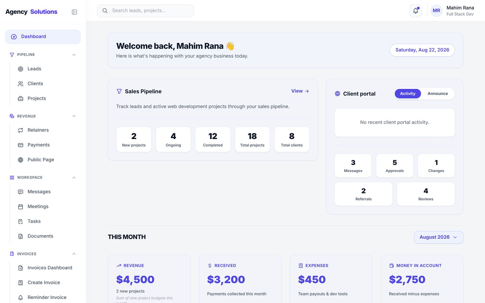
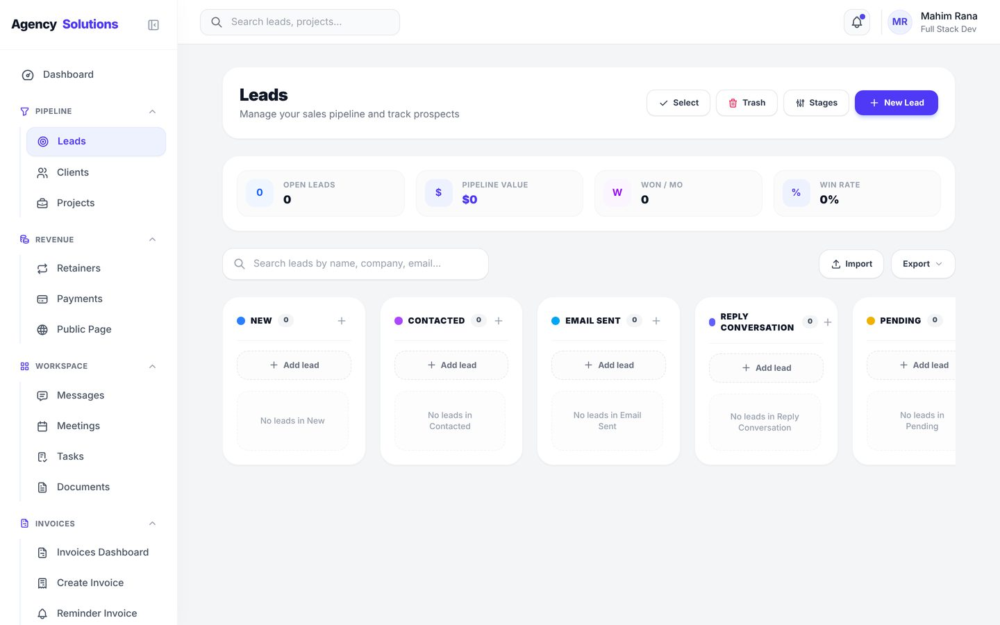
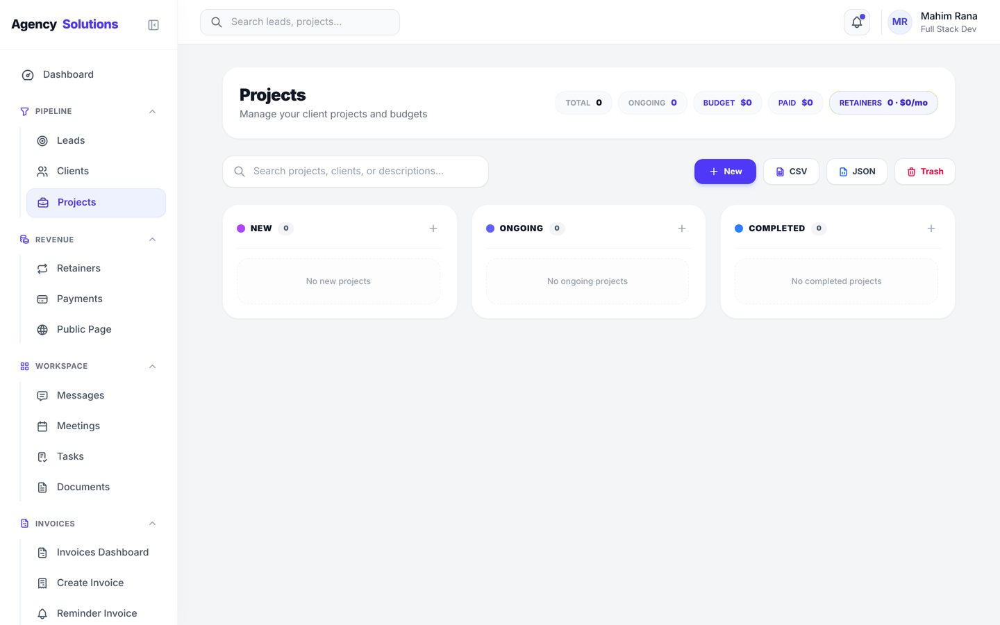
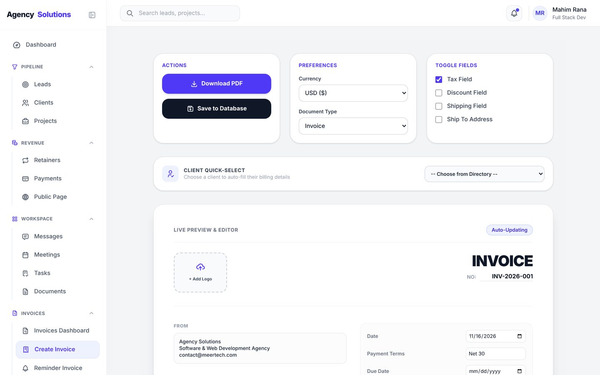
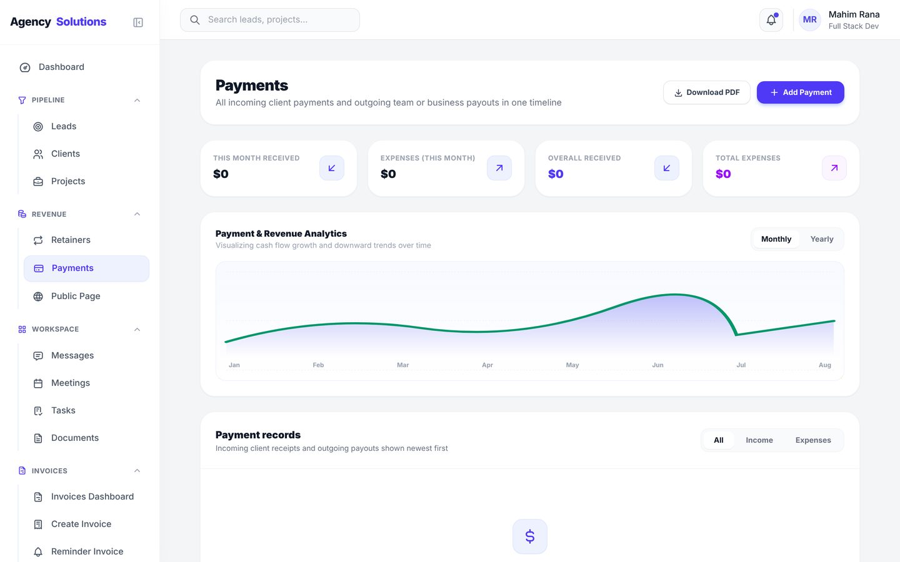
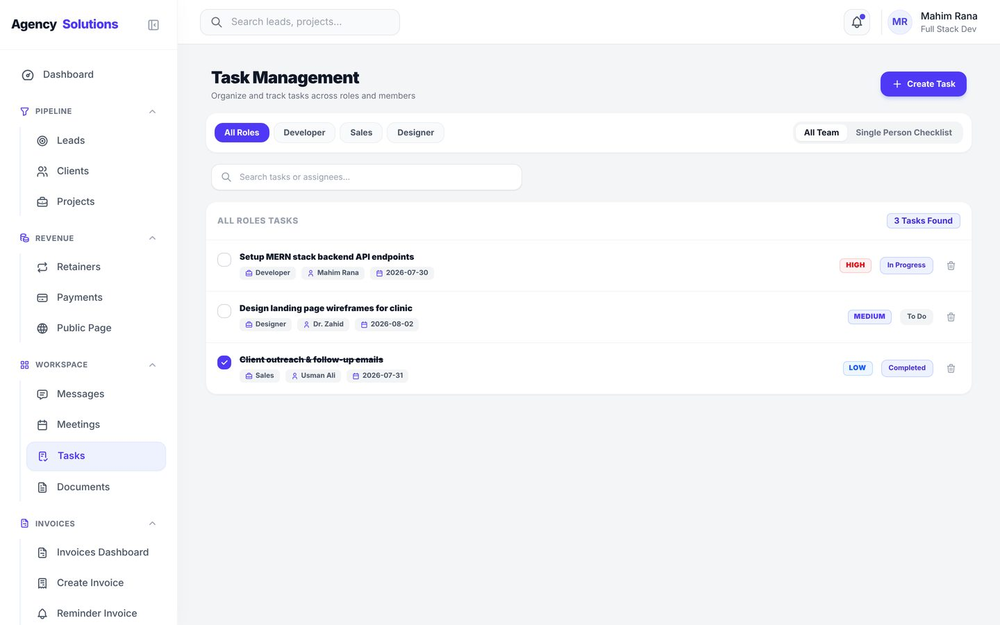
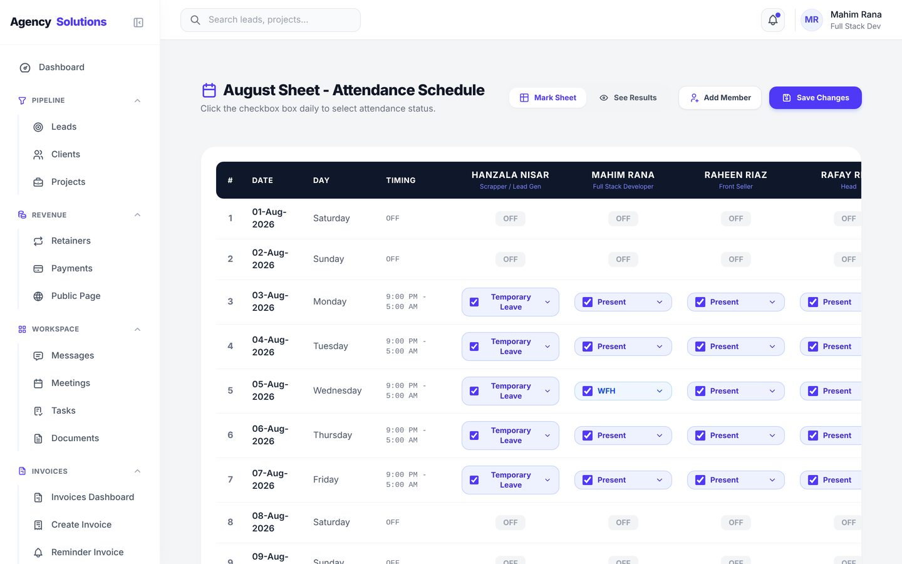
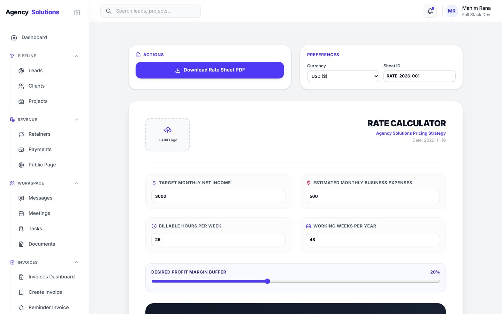

<div align="center">

# 🚀 Agency Solutions CRM

### The all-in-one operating system for agencies & freelancers

Leads, clients, projects, invoices, contracts, payroll, attendance and finance tools: one clean dashboard to run the whole business.




</div>

---

## ✨ Why Agency Solutions?

Most agencies juggle 6–10 different tools: a CRM for leads, a spreadsheet for projects, a separate app for invoices, Google Docs for contracts, another for attendance. **Agency Solutions brings all of it into one workspace**, built around how a real agency actually works: from first lead → signed contract → delivered project → paid invoice.

## 🧩 Modules

| Area | What you get |
|---|---|
| **📊 Dashboard** | Live overview of pipeline, client-portal activity, monthly revenue, payments received, expenses and money in account |
| **🎯 Pipeline** | Leads board, client records and project tracking with status and budgets |
| **💰 Revenue** | Retainers, payments tracking and a public agency page |
| **🗂️ Workspace** | Team messages, meeting scheduler, task board and document hub |
| **🧾 Invoices & Documents** | Invoice builder with **PDF export**, payment reminders, quotations, project proposals, scope of work, freelance contracts, NDAs, retainer agreements, client onboarding and welcome packs |
| **🧮 Business Calculators** | Freelance rate, profit margin, retainer, GST and TDS calculators |
| **👥 Organization** | Team management, billing, **attendance** and **payroll** |
| **💸 Expenses** | Expense tracking feeding straight into the finance dashboard |
| **⚙️ Settings** | Profile, workspace settings and integrations (WhatsApp, Stripe, SMTP) |

## 📸 Screenshots

| Leads pipeline | Projects |
|---|---|
|  |  |

| Invoice builder | Payments |
|---|---|
|  |  |

| Task board | Attendance |
|---|---|
|  |  |

| Freelance rate calculator |
|---|
|  |

## 🛠️ Tech stack

- **React 19** + **Vite** for a fast, modern SPA
- **Tailwind CSS 4** for a consistent design system
- **React Router 7** for 35+ routed screens
- **Framer Motion** for smooth UI transitions
- **html2pdf.js** for client-ready PDF invoices and documents
- **Tabler Icons** for a clean, consistent icon set

## 🏗️ Project structure

```
src/
├── Components/
│   ├── Layout/        # AppShell, collapsible Sidebar, Topbar
│   ├── Uiux/          # Reusable Button, Card, Input
│   └── Dashboard/
│       ├── Pipeline/      # Leads, Clients, Projects
│       ├── Revenue/       # Retainers, Payments, Public page
│       ├── Workspace/     # Messages, Meetings, Tasks, Documents
│       ├── Invoices/      # Invoices, proposals, contracts, NDAs…
│       ├── Calculators/   # Rate, margin, retainer, GST, TDS
│       ├── Organization/  # Team, Billing
│       ├── Attendance/ · Payroll/ · Expenses/ · Settings/
│       └── Dashboard.jsx
├── App.jsx            # Routes
└── main.jsx
```

## 🚀 Run locally

```bash
git clone https://github.com/mahimrana219/agency-crm-system.git
cd agency-crm-system
npm install
npm run dev
```

> ℹ️ This repository contains the **frontend**. The backend (Node.js, Express, MongoDB, JWT auth, Google OAuth, multi-organization memberships and role-based access) is kept private.

---

<div align="center">

**Built by [Mahim Rana](https://mahimrana-portfolio.vercel.app/)** · Full-Stack Developer

[Portfolio](https://mahimrana-portfolio.vercel.app/) · [LinkedIn](https://www.linkedin.com/in/mahimrana219/) · [Email](mailto:mahimrana219@gmail.com)

</div>
